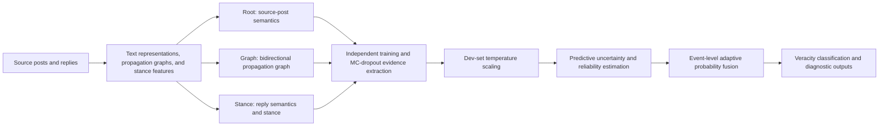

```markdown
# UA-TAF

An uncertainty-aware three-branch evidence fusion framework for social media rumor detection. The model integrates **source-post semantics (Root)**, **propagation structure (Graph)**, and **reply stance and semantics (Stance)**, and employs MC-dropout, temperature scaling, and event-level adaptive weighting to predict rumor veracity classes.

## Method Overview



- **Root branch**: Reads cached source-post embeddings and trains a projection layer and classification head. The Transformer backbone is not fine-tuned at this stage.
- **Graph branch**: Uses node text representations and propagation edges to model propagation structures with a bidirectional GCN.
- **Stance branch**: Combines reply semantics, stance features, and depth information to predict event veracity. Reply-level stance classification is performed during the data preparation stage.
- **Fusion stage**: Freezes the three branches, fits temperature parameters on the Dev set, and then performs uncertainty estimation and adaptive weighted fusion using calibrated MC probabilities.


## Directory Structure

```text
.
├── UA-TAF/
│   ├── train_encoders.py                 # Independent training and evidence extraction for three branches
│   ├── train_dual_uncertainty_fusion.py  # Temperature scaling, fusion evaluation, and ablation
│   ├── encoder/                          # Root / Graph / Stance encoders
│   ├── fusion/                           # Uncertainty estimation and fusion modules
│   └── tests/                            # Tests for fusion, data splits, and analysis logic
├── Process/                              # Data export, graph construction, and stance feature processing
├── data/                                 # Raw data, CSV files, graph NPZ files, and split metadata
├── pretrained/                           # Local pretrained model resources
├── results/                              # Training, fusion, and analysis outputs
├── requirements-local.txt                # Local environment dependencies
```

## Quick Start

### 1. Prepare the dataset

```bash
python Process/export_raw_datasets_to_csv.py --dataset rumoureval2019
python Process/prepare_rumoureval2019_graph.py
```

### 2. Train the three evidence encoders

```bash
python UA-TAF/train_encoders.py \
    --dataset RumourEval2019 \
    --iteration 0 \
    --branch all \
    --mc-samples 20 \
    --num-workers 0
```

### 3. Calibrate and fuse

```bash
python UA-TAF/train_dual_uncertainty_fusion.py \
    --evidence-dir results/UA_TAF_training/RumourEval2019/iter0/evidence \
    --output-dir results/UA_TAF_training/RumourEval2019/iter0/fusion_test \
    --evaluate-split test \
    --alpha 1.0
```

### Datasets and Labels

| `--dataset` | Default thread CSV (`data/csv/`) | Default graph directory | Class order |
|---|---|---|---|
| `RumourEval2019` | `RumourEval2019_threads.csv` | `data/RumourEval2019graph/` | FR, TR, UR |
| `PHEME` | `PHEME_threads.csv` | `data/PHEME4Lgraph/` | NR, FR, TR, UR |

NR denotes non-rumor, FR denotes false rumor, TR denotes true rumor, and UR denotes unverified rumor. Training uses `y` from the graph NPZ files as the label source.

Each event is stored as `<event_id>.npz`. The main fields include:

| Field | Description |
|---|---|
| `x` | Node text representations, with a default input dimension of 768 |
| `edgeindex` | Propagation graph edges |
| `root` | Cached source-post representation |
| `rootindex` | Index of the source-post node |
| `y` | Event veracity label |
| `stance_x` | Node stance features, with a default dimension of 16 |


### RumourEval2019 Preprocessing

Place the raw data under `data/rumoureval2019/` and prepare the model weights, configuration, and tokenizer files under `pretrained/bertweet-base/`. Then run:

```bash
python Process/export_raw_datasets_to_csv.py --dataset rumoureval2019
python Process/prepare_rumoureval2019_graph.py
```

The generated files include the thread and node tables under `data/csv/`, graph files under `data/RumourEval2019graph/`, and metadata under `data/RumourEval2019/`. If the dataset has already been correctly preprocessed, these steps can be skipped.

### PHEME Preprocessing and Path Configuration

The two preprocessing stages and the training entry point do not use directly matching default paths, so the input and output directories should be specified explicitly:

| Stage | Script | Path description |
|---|---|---|
| Basic graph construction | `Process/prepare_pheme4_bigcn_bertweet.py` | Outputs `data/PHEME4graph/` and `data/PHEME4/` |
| Stance feature generation | `Process/generate_pheme_stance.py` | Default input: `PHEME4PLMgraph`; default output: `PHEME4Stancegraph`. The commands below override these defaults. |
| Three-branch training | `UA-TAF/train_encoders.py --dataset PHEME` | Default graph directory: `data/PHEME4Lgraph/`; corresponding metadata directory: `data/PHEME4L/` |

The complete data flow is:

```text
PHEME raw data → PHEME4graph → add stance_x → PHEME4Lgraph → three-branch training
                    PHEME4  → copy metadata → PHEME4L
```

First prepare the raw data and the local text encoding model, and check the hard-coded paths in the graph construction script. Then export the CSV files and construct the basic graphs:

```bash
python Process/export_raw_datasets_to_csv.py --dataset pheme
python Process/prepare_pheme4_bigcn_bertweet.py
```

After preparing the trained reply-level stance classifier (default location: `checkpoint/rumoureval_stance/best/`; training entry point: `Process/train_rumoureval_stance_classifier.py`), explicitly connect the input and output directories:

```bash
python Process/generate_pheme_stance.py \
    --source-graph-dir data/PHEME4graph \
    --output-graph-dir data/PHEME4Lgraph \
    --source-meta-dir data/PHEME4 \
    --output-meta-dir data/PHEME4L \
    --model-dir checkpoint/rumoureval_stance/best
```

This step preserves the original graph fields, adds `stance_x`, and copies the metadata. After completion, check `data/PHEME4Lgraph/generation_report.json` for failed or missing events before running the PHEME training command below.

Simply renaming `PHEME4graph` to `PHEME4Lgraph` does not generate stance features. If training is explicitly performed with `--graph-dir data/PHEME4graph`, `stance_x` should also be checked. If it is missing, zero-filled stance inputs are used and the result should not be considered a complete stance-branch experiment.

### Data Split Protocol

- **RumourEval2019**: `--iteration` denotes an independent training repetition and does not represent a cross-validation fold.
- **PHEME**: By default, five folds are automatically executed for each iteration. A single fold can be specified using `--fold-id 0`. The implementation follows the original BiGCN-style within-class five-fold partitioning and then splits the training pool to obtain a Dev set. Due to floor rounding within each class, the remaining tail samples are retained in the training pool for each fold.

For non-PHEME datasets, if `folds.pkl` exists, its splits are used preferentially, followed by a Dev split from the training pool. Otherwise, the split information in the CSV files is used. The actual splitting logic is implemented in `UA-TAF/encoder/path_utils.py`; the split protocol should not be inferred solely from the dataset name.

## Training and Evaluation

### 1. Train the Three Branches and Export Dev Evidence

```bash
python UA-TAF/train_encoders.py \
    --dataset RumourEval2019 \
    --iteration 0 \
    --branch all \
    --mc-samples 20 \
    --num-workers 0
```

The three branches are trained independently. Checkpoints are selected according to Dev Macro-F1, with Dev NLL used as a secondary criterion in the case of ties. `--branch` can be set to `root`, `graph`, or `stance`. Complete evidence from all three branches under the same data split is required before fusion.

Common parameters:

| Parameter | Default | Description |
|---|---:|---|
| `--epochs` | `80` | Maximum number of training epochs |
| `--patience` | `15` | Early-stopping patience |
| `--batch-size` | `16` | Batch size |
| `--mc-samples` | `20` | Number of stochastic samples used for evidence extraction |
| `--seed` | `2026` | Base random seed |
| `--export-test` | Disabled | Also export Test evidence |
| `--input-csv` / `--graph-dir` | Dataset-dependent | Custom input paths |
| `--output-dir` | Dataset- and iteration-dependent | Custom output directory |

Run `python UA-TAF/train_encoders.py --help` for the complete list of parameters. When repeating the same configuration, pay attention to the output directory to avoid overwriting existing results.

### 2. Dev Calibration and Fusion

```bash
python UA-TAF/train_dual_uncertainty_fusion.py \
    --evidence-dir results/UA_TAF_training/RumourEval2019/iter0/evidence \
    --output-dir results/UA_TAF_training/RumourEval2019/iter0/fusion_dev \
    --evaluate-split dev \
    --alpha 1.0
```

Temperature parameters are always fitted on the Dev set. `--alpha` controls the adaptive fusion strength, with a default value of `1.0`. This stage does not jointly retrain the three encoders.

### 3. Test Evaluation with Frozen Configuration

During formal training, enable `--export-test` and then run Test fusion:

```bash
python UA-TAF/train_encoders.py \
    --dataset RumourEval2019 \
    --iteration 1 \
    --branch all \
    --mc-samples 20 \
    --export-test \
    --num-workers 0

python UA-TAF/train_dual_uncertainty_fusion.py \
    --evidence-dir results/UA_TAF_training/RumourEval2019/iter1/evidence \
    --output-dir results/UA_TAF_training/RumourEval2019/iter1/fusion_test \
    --evaluate-split test \
    --alpha 1.0
```

A new iteration number is used here to distinguish formal independent runs. If a formal training result already contains Test evidence, the fusion stage can be executed directly. The Test set is not used for checkpoint selection, temperature fitting, or hyperparameter tuning. `reexport_mc_evidence.py` depends on existing Dev/Test evidence and cannot create missing Test evidence from scratch.

PHEME single-fold training example:

```bash
python UA-TAF/train_encoders.py \
    --dataset PHEME \
    --iteration 0 \
    --fold-id 0 \
    --branch all \
    --export-test \
    --num-workers 0
```

The corresponding evidence directory is:

```text
results/UA_TAF_training/PHEME/iter0/fold0/evidence/
```

Removing `--fold-id` automatically runs all five folds.

## Acknowledgments and Citation

This project uses open-source tools including PyTorch, PyTorch Geometric, and Transformers. When using the datasets, pretrained models, or baseline implementations, please follow the corresponding licenses and citation requirements.

### RumourEval2019

**Dataset:**

Derczynski, L., Gorrell, G., Zubiaga, A., Aker, A., Bontcheva, K., Liakata, M., & Kochkina, E. (2019). *RumourEval 2019 data*. Figshare. CC BY 4.0.

**Paper:**

Gorrell, G., Kochkina, E., Liakata, M., Aker, A., Zubiaga, A., Bontcheva, K., & Derczynski, L. (2019). *SemEval-2019 Task 7: RumourEval, Determining Rumour Veracity and Support for Rumours*. Proceedings of the 13th International Workshop on Semantic Evaluation, 845–854. ACL Anthology.

### PHEME

**Dataset:**

Kochkina, E., Liakata, M., & Zubiaga, A. (2018). *PHEME dataset for Rumour Detection and Veracity Classification*. Figshare.

**Paper:**

Zubiaga, A., Liakata, M., Procter, R., Wong Sak Hoi, G., & Tolmie, P. (2016). *Analysing How People Orient to and Spread Rumours in Social Media by Looking at Conversational Threads*. PLoS ONE, 11(3), e0150989. PLOS.

### BERTweet

**Paper:**

Nguyen, D. Q., Vu, T., & Nguyen, A. T. (2020). *BERTweet: A Pre-trained Language Model for English Tweets*. Proceedings of the 2020 Conference on Empirical Methods in Natural Language Processing: System Demonstrations, 9–14.
```
